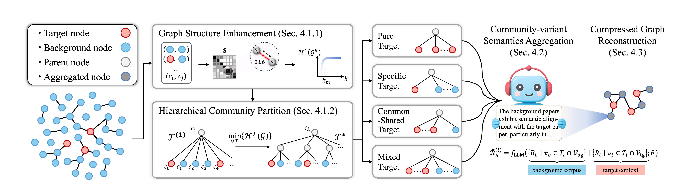

# $\text{H}\text{S}_2\text{C}$
$\text{H}\text{S}_2\text{C}$: Homophily-aware Structural and Semantic Compression for Text-Attributed Graph Understanding with LLM

## Project Overview
`Abstract` Large language models (LLMs) have demonstrated promising performance in text-attributed graph (TAG) understanding, such as node classification. Recent studies focus on verbalizing the graph structures by handcrafted prompts for LLMs, typically incorporating the target node information and its neighborhood background context. However, due to limited hardware resources and heavy computational overhead, LLMs often struggle to process complete graph within the input length limitation. A straightforward solution is \textbf{graph compression}, dropping some nodes/edges randomly or according to node-level importance criteria (e.g., degree, semantic similarity). Nevertheless, these rash methods overlook the \textit{global structure} and \textit{semantic information} from a local perspective, leading to significant reasoning fluctuations. To solve this problem, we propose a \uline{H}omophily-aware \uline{S}tructural and \uline{S}emantic \uline{C}ompression for LLM, named $\text{H}\text{S}_2\text{C}$, discovering the community-level graph homophily. Specifically, we first conduct an entropy-guided hierarchical structure partition of the TAG, which detects groups of structurally homophilic nodes utilizing the coding tree. Secondly, based on predefined community types, we apply differentiated summary of background nodes within each community, selectively preserving semantically homophilic information aligned with the target nodes. Finally, we reconstruct the compressed graph for downstream inference. Extensive experiments on 6 real-world TAG benchmarks demonstrate that $\text{H}\text{S}_2\text{C}$ simultaneously enhances the compression rate and downstream task accuracy, outperforming all the baselines. Typically, on the OGBN-ArXiv dataset, $\text{H}\text{S}_2\text{C}$ achieves a 94.98\% graph scale compression while improving classification accuracy by 3.06\%–4.92\%. Our method significantly reduces LLM reasoning fluctuations compared with random neighbor selection.  Our code is availiable at [https://anonymous.4open.science/r/HS\_2C-9775](https://anonymous.4open.science/r/HS_2C-9775).

## Dependancy
PYTHON 3.8, PyTorch 2.0.0, PyTorch Geometric 2.5.3, transformers 4.46.3
